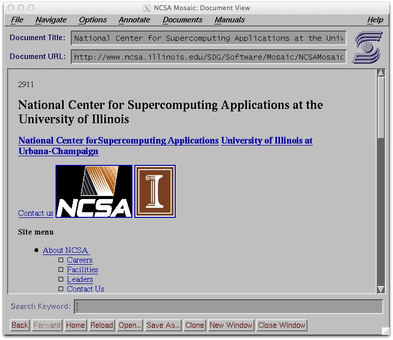
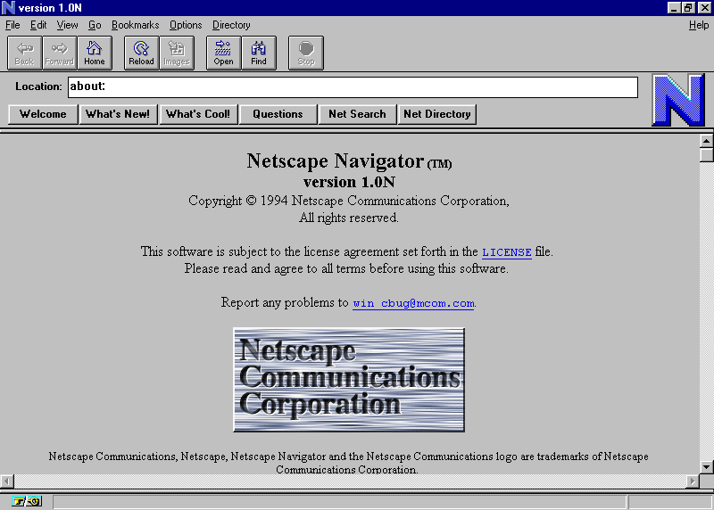

# IPv4 vs IPv6

## IPv4


How big is it really?

### In theory

- [IPv4](https://en.wikipedia.org/wiki/IPv4) uses a 32-bit address
    - four octets, each octet is 8 bits
    - e.g. `192.168.1.1` is `11000000` `10101000` `00000001` `00000001`
    - decimal numbers with dots makes it easier to read
- 2³² = ~4.3 billion possible addresses

### The internet got popular

- in the early days, it seemed like plenty!
    - the internet started as a US military/university research project, and billions of devices was unfathomable
    - until the 90s when... US politics happened!
        - 1991: [High Performance Computing and Communication Act of 1991](https://en.wikipedia.org/wiki/High_Performance_Computing_Act_of_1991) funded the internet backbone ([NSFNet](https://en.wikipedia.org/wiki/National_Science_Foundation_Network)) to be run by the [National Science Foundation](https://en.wikipedia.org/wiki/National_Science_Foundation)
            - ...and commercial content was forbidden
        - 1993: NSF decommissioned NSFNet and handed control to commercial ISPs
            - ...and privatization allowed commercial content
        - 1996: [The Telecommunications Act of 1996](https://en.wikipedia.org/wiki/Telecommunications_Act_of_1996) further deregulated broadcast/phone companies and incentivied their network expansion
    - also, GUI web browsers started getting good
        - 1993: [NCSA Mosiac](https://en.wikipedia.org/wiki/NCSA_Mosaic) developed at the [National Center for Supercomputing Applications](https://en.wikipedia.org/wiki/National_Center_for_Supercomputing_Applications) at the University of Illinois
        - 1994: Mosaic cocreator (graduated in 93) released [Netscape Navigator](https://en.wikipedia.org/wiki/Netscape_Navigator) _as a **commercial** product_





### It wasn't even 4.3 billion...

- not all addresses are usable for public internet devices
- large blocks are reserved for special purposes...

| Range | Purpose | Size |
|---|---|---|
| `10.0.0.0/8` | [Private (RFC 1918)](https://en.wikipedia.org/wiki/Private_network) | ~16.7 million |
| `172.16.0.0/12` | [Private (RFC 1918)](https://en.wikipedia.org/wiki/Private_network) | ~1 million |
| `192.168.0.0/16` | [Private (RFC 1918)](https://en.wikipedia.org/wiki/Private_network) | ~65,000 |
| `127.0.0.0/8` | [Loopback (`localhost`)](https://en.wikipedia.org/wiki/Localhost) | ~16.7 million |
| `169.254.0.0/16` | [Link-local (APIPA)](https://en.wikipedia.org/wiki/Link-local_address) | ~65,000 |
| `224.0.0.0/4` | [Multicast](https://en.wikipedia.org/wiki/Multicast_address) | ~268 million |
| `240.0.0.0/4` | [Reserved for "future use"](https://en.wikipedia.org/wiki/List_of_reserved_IP_addresses) | ~268 million |
| Various others | [Documentation, benchmarking, etc.](https://en.wikipedia.org/wiki/List_of_reserved_IP_addresses) | ~few thousand |

- (more on the subnets in the next section)
- after removing reserved ranges, there are roughly `3.7 billion` publicly routable addresses
- early addresses were assigned *very* wastefully
    - see also [List of assigned /8 IPv4 address blocks](https://en.wikipedia.org/wiki/List_of_assigned_/8_IPv4_address_blocks)
    - each /8 block has `16.7 million` public addresses!
    - MIT got a /8 block, some big corporations (AT&T, Apple, etc.) each got /8 blocks, US military got multiple /8 blocks
- [IANA](https://en.wikipedia.org/wiki/Internet_Assigned_Numbers_Authority) officially exhausted its pool of IPv4 address blocks in 2011
- regional registries ([ARIN](https://en.wikipedia.org/wiki/American_Registry_for_Internet_Numbers), [RIPE](https://en.wikipedia.org/wiki/RIPE_NCC), etc.) ran out of addresses between 2011 and 2019
- "new" IPv4 addresses are long gone
- IPv4 addresses are now bought and sold on secondary markets at $50 or more per address

---

## Subnets

- subnets are logical subdivisions of an IP network
- are hierarchically nested like a real-world addresses
    - country → city → street → house
    - [IANA](https://en.wikipedia.org/wiki/Internet_Assigned_Numbers_Authority) → [regional internet registry](https://en.wikipedia.org/wiki/Regional_Internet_registry) → internet service provider → individual customer

### Subnet masks and CIDR notation

- every IP address has two parts: `network` and `host` portions
    - a **subnet mask** says which bits belong to the network vs a host in that network
- example `192.168.1.0/24`
    - `/24` = the **first** 24 bits are the network prefix
    - the remaining 8 bits = available for local addresses (`0`–`255`)
    - `192.168.1.0` = the network address (first, not assignable to devices)
    - `192.168.1.255` = the broadcast address (last, not assignable)
    - `192.168.1.1` – `192.168.1.254` = usable host addresses (254 devices)

```
IP:   192     .168     .1       .42
Bits: 11000000.10101000.00000001.00101010
Mask: 11111111.11111111.11111111.00000000
      <----network (24 bits)--->|<-host->
```

- historic note: subnets used to be defined by "classes"
    - class A = `/8`
    - class B = `/16`
    - class C = `/24`
    - classful addressing wasted huge blocks; you got one of those, and nothing in between
- [CIDR (Classless Inter-Domain Routing)](https://en.wikipedia.org/wiki/Classless_Inter-Domain_Routing) notation (`/24`, `/16`, `/8`, etc.) replaced the old class system
    - CIDR lets you slice exactly as small or large as you need: a `/27` gives you 30 hosts, a `/22` gives you 1022 hosts

### Why subnets matter

- **Isolation**: devices on different subnets don't talk directly — traffic must go through a router
    - a database server on a separate subnet from your web servers can only be reached through controlled routing rules
- **Broadcast containment**: broadcast packets (sent to the whole subnet) stay within the subnet
    - a `/8` subnet with 16 million devices broadcasting constantly would be chaos
- **Organization**: subnets map to physical locations, departments, or security zones in enterprise networks
    - "the `10.10.1.0/24` is the finance VLAN; `10.10.2.0/24` is engineering"

### Routing between subnets

- Routers maintain routing tables: "packets destined for `10.10.2.0/24` go out this interface"
- Routing decisions use **longest prefix match** — the most specific matching subnet wins
    - packet to `10.10.2.42`: matches both `10.0.0.0/8` and `10.10.2.0/24`
    - router picks `/24` (more specific) and routes it there

---

## NAT (Network Address Translation)

### The problem

- we (in the past) expect to run out IPv4 addresses, but *billions* of devices are expected to exist...
- solution? Locally reuse the same *private IP ranges* that are not routable on the public internet
    - devices inside the home get addresses like `192.168.1.x` from a local router
    - the router gets *one* public IP address from the ISP
    - same basic logic applies in larger corporate offices
- but how do devices without a public address talk to and from public addresses?

### How NAT works

- [NAT](https://en.wikipedia.org/wiki/Network_address_translation) is an active mapping that lives in your router between the private network and the public internet
- whenever a packet leaves the private network:
    1. the router rewrites the *source IP* from the local system's private address (`192.168.1.42`) to the router's public IP (`203.0.113.5`)
    2. the router records the mapping in a local NAT translation table (`192.168.1.42:51234` ↔ `203.0.113.5:51234`) using a custom high-number port
    3. the packet goes out to the internet looking like it came from the router's public IP
- when a response comes back:
    1. the router checks the destination port mapping in the NAT table
    2. it rewrites the *destination IP* back to the local system's private address
    3. it delivers the packet normally to the device like nothing happened

```
Your laptop          Your router           Web server
192.168.1.42    <--> 203.0.113.5 (public)  93.184.216.34

Outgoing: src=192.168.1.42:51234 → [NAT] → src=203.0.113.5:51234
Incoming: dst=203.0.113.5:51234 → [NAT] → dst=192.168.1.42:51234
```

- technically this is [PAT (Port Address Translation)](https://en.wikipedia.org/wiki/Network_address_translation#One-to-many_NAT) or "NAT overload" where one public IP address is multiplexed/shared across many private devices using port numbers to track sessions
    - there are other methods, but this is by far the most popular
- the result: the internet thinks everything in your home or office is one single device

### Side effects of NATnig

- it's like a "free" firewall
    - unsolicited inbound connections can't reach private hosts when there's no NAT table entry for them
- it breaks many peer-to-peer communications
    - if two NATted devices want to talk directly, neither has a public address the other can reach
    - other techniques were created like [STUN](https://en.wikipedia.org/wiki/STUN), [TURN](https://en.wikipedia.org/wiki/Traversal_Using_Relays_around_NAT), [ICE](https://en.wikipedia.org/wiki/Interactive_Connectivity_Establishment) to work around this limitation; those are used by WebRTC, video calling, gaming
    - or use [port forwarding](https://en.wikipedia.org/wiki/Port_forwarding) to manually poke a hole in the router's NAT to make a server connection directly reachable
- breaks some protocols that embed IP addresses in their payload not just the packets (old FTP, SIP) because the NAT only rewrites packet headers, not the body payloads
- so, true end-to-end connectivity becomes challenging

---

## IPv6

### What changed and why

- IPv6 was standardized in [RFC 2460](https://en.wikipedia.org/wiki/IPv6) (1998), but adoption has been *very* slow
- original motivation was the IPv4 address exhaustion

### IPv6 addresses

- **128-bit addresses** vs. IPv4's 32-bit
    - written as 8 groups of 4 hex digits: `2001:0db8:85a3:0000:0000:8a2e:0370:7334`
    - leading zeros in each group can be dropped: `2001:db8:85a3:0:0:8a2e:370:7334`
    - one run of consecutive all-zero groups can be collapsed to `::`: `2001:db8:85a3::8a2e:370:7334`
- 2¹²⁸ = **~340 undecillion** addresses (~340,000,000,000,000,000,000,000,000,000,000,000,000 or 10^36)
    - or about 670 quadrillion addresses per square millimeter of the surface of the Earth
- should ACTUALLY be enough for the foreseeable future

### IPv6 special addresses

| Address | Purpose |
|---|---|
| `::1` | Loopback (equivalent to `127.0.0.1`) |
| `fe80::/10` | Link-local (auto-configured, not routable) |
| `fc00::/7` | Unique local (like RFC 1918 private ranges) |
| `ff00::/8` | Multicast |
| `2000::/3` | Global unicast (publicly routable) |

### Key differences from IPv4

- **No broadcast**: IPv6 replaces broadcast with [multicast](https://en.wikipedia.org/wiki/Multicast_address#IPv6) and [anycast](https://en.wikipedia.org/wiki/Anycast)
    - "all nodes on this link" = multicast to `ff02::1`
    - more efficient — only interested nodes receive the traffic
- **Stateless Address Autoconfiguration ([SLAAC](https://en.wikipedia.org/wiki/IPv6#Stateless_address_autoconfiguration_(SLAAC)))**: devices can self-assign a global address without DHCP
    - the router advertises the network prefix; the device appends a unique host portion
    - originally used the device's MAC address to generate the host portion (privacy implications below)
- **Simplified header**: IPv6 header is actually *simpler* than IPv4's
    - IPv4 had a variable-length header with optional fields; IPv6 uses fixed 40-byte header + extension headers
    - routers can process packets faster
- **IPsec built-in**: IPv6 was designed with [IPsec](https://en.wikipedia.org/wiki/IPsec) support as a first-class feature
    - in practice, not always used, but it's in the spec
- **Neighbor Discovery Protocol ([NDP](https://en.wikipedia.org/wiki/Neighbor_Discovery_Protocol))** replaces [ARP](https://en.wikipedia.org/wiki/Address_Resolution_Protocol)
    - ARP was IPv4's way of asking "who has IP `192.168.1.1`? Tell me your MAC."
    - NDP does the same job but is part of the IPv6 protocol proper (ICMPv6), not a separate protocol

### IPv4 vs. IPv6 network size

| | IPv4 | IPv6 |
|---|---|---|
| Address length | 32-bit | 128-bit |
| Total addresses | ~4.3 billion | ~340 undecillion |
| Usable public addresses | ~3.7 billion (minus reservations) | Vast — every person on Earth could have trillions |
| Typical subnet | `/24` = 254 hosts | `/64` = 18 quintillion hosts (standard subnet size) |
| Practical reality | Stretched thin via NAT | Enough to give every device a globally unique public address |

The IPv6 standard allocates a **/64** as the minimum routable subnet — and there are still more /64 subnets available than IPv4 has total addresses.

---

## Is NAT Still Relevant with IPv6?

### The short answer: no...

- IPv6 was explicitly designed to eliminate the need for NAT
- with 2¹²⁸ addresses, every device can have its own globally unique, publicly routable address
- No address sharing = no NAT required for connectivity

### But NAT66 technically exists too

- [NAT66](https://en.wikipedia.org/wiki/IPv6#NAT66) (IPv6-to-IPv6 NAT) exists and some organizations use it
- Common reasons:
    - **Provider independence**: use one internal addressing scheme regardless of which ISP you use
        - when you change ISPs, your internal addresses don't change, only the NAT mapping does
    - **Security habit**: some network admins insist on NAT as a security boundary (even though it isn't one)
    - **Legacy policy**: corporate policy was written assuming NAT exists

### NAT was always just security theater, not real security

- NAT's "firewall effect" is a side effect, not a real security mechanism
    - stateful firewalls provide the same inbound-connection blocking *without* NAT
- IPv6 networks should use a stateful firewall to block unsolicited inbound connections
    - this is cleaner because you get the security *behavior* without the connectivity-breaking side effects
- The Internet Engineering Task Force (IETF) [actively discourages NAT66](https://www.rfc-editor.org/rfc/rfc5902) for general use

---

## IPv6 and privacy concerns

### The original problem: stable global addresses

- The first SLAAC implementations used the device's **MAC address** to generate the last 64 bits of its IPv6 address ([EUI-64](https://en.wikipedia.org/wiki/MAC_address#Derived_EUI-64))
    - MAC address is globally unique and burned into your hardware
    - your IPv6 address would be the same everywhere you connected
    - a website (or any observer) could track you across different networks, different ISPs, different countries — your MAC never changes

### The solution: privacy extensions

- [RFC 4941 - Privacy Extensions for SLAAC](https://en.wikipedia.org/wiki/IPv6#Privacy)
    - devices generate a **random** host portion instead of using the MAC address
    - the random address rotates periodically (typically every few days)
    - this is enabled by default on modern OSes (macOS, Windows, most Linux distros)
- Modern devices often have **two** IPv6 addresses simultaneously:
    - a **stable** address (used for *incoming* connections, like a server; derived from the MAC or a stable random value)
    - a **temporary** address (used for *outgoing* connections; rotates frequently)
    - you can see both with `ip addr` on Linux or `ifconfig` on macOS

### Remaining privacy considerations

- even with rotating addresses, the **network prefix** (first 64 bits) reveals your network/ISP/location
- privacy extensions help against *tracking across networks* but not against the network you're on right now
- IPv6 privacy is roughly equivalent to IPv4 + NAT in terms of anonymity — not better, not catastrophically worse
- for serious privacy, there are othert protocols... (maybe we can talk about tor later?)
